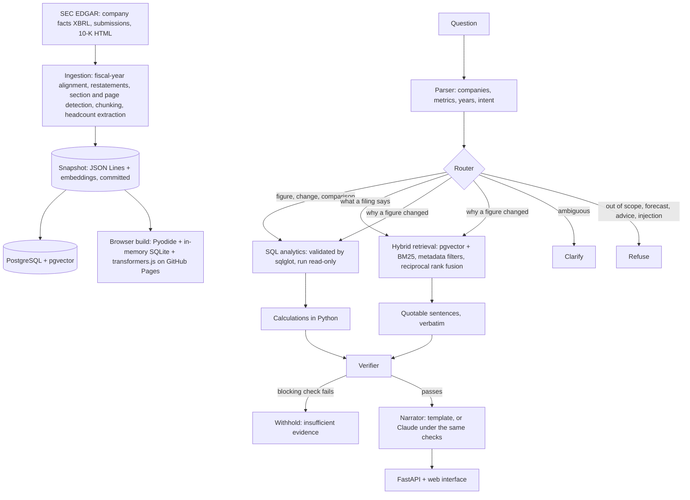

# Footnote

**An auditable research assistant for SEC annual reports.** Ask a question about fifteen US companies' 10-K filings and Footnote returns a short answer, a citation for every figure down to the statement and page, the calculation behind any derived number, a verification status, and a plain refusal when the filings do not support an answer.

[](https://github.com/pablowilliams/footnote/actions/workflows/ci.yml)

**[Live demo, running entirely in your browser](https://pablowilliams.github.io/footnote/)** · [Demo video, 75 seconds](docs/media/demo.mp4) · [Evaluation report](docs/evaluation.md) · [Failure analysis](docs/failure-analysis.md) · [Design note](docs/design-note.md) · [Architecture](docs/architecture.md) · [Data model](docs/data-model.md) · [API](docs/api.md)

---

## The problem

An analyst who asks a language model "how did Apple's operating margin change?" gets a fluent answer and no way to check it. The figure may be right, rounded, taken from the wrong fiscal year, or invented. In finance the cost of a plausible wrong number is higher than the cost of no answer, so a research tool has to show where every number came from and has to be willing to say "the filings do not tell me that".

Footnote is built around that requirement. The language model, where one is used at all, never does arithmetic and never states a figure the evidence does not contain. Every number is read from a filing or computed in code, and a verifier re-checks the draft answer against its own sources before it is shown.

## What it does

```text
Q: How did Apple's revenue and operating margin change between 2023 and 2025?

Apple's revenue rose from $383.3 billion in fiscal 2023 [1] to $416.2 billion in fiscal 2025 [2],
an increase of 8.6%, or 4.2% a year compounded. Its operating margin rose from 29.8% in
fiscal 2023 [1] to 32.0% in fiscal 2025 [2], up 2.1 percentage points.

[1] Apple Inc., Form 10-K for fiscal 2023 (filed 2023-11-03), Consolidated statement of operations, page 28
[2] Apple Inc., Form 10-K for fiscal 2025 (filed 2025-10-31), Consolidated statement of operations, page 29

Status: verified · Route: structured query and calculation · 94 ms
Checks: every figure cited, 7 figures traced to source or calculation, 5 calculations reproduced
from their inputs, units consistent, periods match, described direction matches the calculation
```

```text
Q: What will Nvidia's revenue be in fiscal 2028?
Status: refused. The system answers from reported results only and does not forecast future figures.

Q: What was Apple's profit in 2024?
Status: ambiguous. "profit" could mean more than one reported figure. Options: operating income, net income.
```

## Try it

**[pablowilliams.github.io/footnote](https://pablowilliams.github.io/footnote/)** runs the whole system in the browser, hosted on GitHub Pages with no server. The Python pipeline runs under Pyodide (WebAssembly), the filings snapshot is loaded into an in-memory SQLite database and a NumPy matrix, and the embedding model runs under transformers.js. It is the same code as the server: parser, router, SQL validation, calculations, hybrid retrieval, verifier. On all 72 evaluation questions it gives the same answer, character for character, as the PostgreSQL deployment. The first visit downloads about 120 MB, which the browser then caches.

## Results

Measured on 72 hand-written questions in eight categories, scored deterministically (no model grades another model). Full report: [docs/evaluation.md](docs/evaluation.md).

| Measure | Result |
|---|---|
| Answer correctness | **98.6%** (71 of 72) |
| Routing accuracy | 100% |
| Citation precision | 100% |
| Refusal precision / recall | 100% / 100% |
| SQL execution success | 100% |
| Gold figures matched (entered by hand from the published statements) | 36 of 36 |
| Median latency | 7 ms for figures and calculations, about 300 ms with document search |
| Model cost per question | $0 by default; no paid model is called |

The first run on the original 67 questions scored 95.5%. The faults behind the misses, and four more found by probing edge cases, are described in the [failure analysis](docs/failure-analysis.md) along with the one question still answered wrongly.

**Data:** 15 companies, 81 annual reports filed from 2021, 7,696 XBRL facts, 740 annual metric values, and 5,618 passages from Items 1, 1A, 7 and 7A of each company's three latest 10-Ks. 97.1% of the figures taken from XBRL were also found, as printed, in the filing text, and 99% of those were located in a named financial statement with a page number.

## How it works



- **Ingestion** reads XBRL company facts for the figures and the 10-K HTML for the text. The fiscal year of a figure is taken from the filing in which that period is the primary one, because the `fy` field on an XBRL fact names the filing's year, not the period's. Restated values replace the original and keep it as lineage.
- **Routing** is rule-based and model-free, so a misroute can be found, tested and fixed.
- **Structured answers** come from parameterised SQL that is parsed and validated before it runs, under a read-only role with a statement timeout.
- **Document answers** quote sentences word for word from passages found by hybrid search, filtered to the right company, year and section.
- **Verification** re-derives every figure and calculation from the cited sources. A blocking failure withholds the answer; an advisory failure releases it as partially verified.

Details: [architecture](docs/architecture.md), [data model](docs/data-model.md), [design note](docs/design-note.md).

## Run it

With Docker:

```bash
docker compose up --build
```

Then open http://localhost:8000. The first start applies migrations and loads the committed snapshot.

Without Docker (needs PostgreSQL 16+ with the pgvector extension):

```bash
make setup
make demo
```

Other commands:

```bash
footnote ask "Compare free cash flow across Apple, Microsoft and Alphabet in 2024"
footnote search "export controls" --ticker NVDA --item 1A
make test        # 92 tests: arithmetic, units, dates, SQL safety, citations, unsupported claims, API, backend parity
make evaluate    # the 72-question evaluation, written to docs/evaluation.md
make ingest      # re-download everything from SEC EDGAR and rebuild the snapshot
```

The optional Claude narrator rewrites the computed sentences into more natural prose. Its output passes through the same number and citation checks, and if it introduces a figure that is not in the evidence it is discarded:

```bash
FOOTNOTE_NARRATOR=claude ANTHROPIC_API_KEY=... make serve
```

## API

| Endpoint | Purpose |
|---|---|
| `POST /ask` | Answer a question; pass `previous_answer_id` to get the evidence behind an earlier answer |
| `GET /search` | Hybrid passage search with company, year and section filters |
| `GET /companies`, `GET /scope` | What the system covers |
| `GET /history` | Recent questions and their status |
| `GET /health`, `GET /metrics` | Readiness and Prometheus metrics |

Interactive documentation is served at `/docs`. The [API reference](docs/api.md) is generated from the OpenAPI schema.

## Scope and limits

Footnote covers fifteen companies, ten metrics from fiscal 2021, and four sections of the three most recent annual reports. It does not forecast, give investment advice, convert currencies or answer about other companies, and it says so. The [failure analysis](docs/failure-analysis.md) sets out where it is weak: a quotation can be verbatim and correctly cited and still not answer the question, generic questions about "risks" draw generic passages, and the evaluation set was written by the same person who built the system.

## Repository

```text
src/footnote/
  ingest/        EDGAR client, XBRL selection, HTML parsing, chunking, headcount extraction
  question.py    deterministic question parser
  graph.py       the LangGraph state graph: parse, route, answer, finalise
  analytics.py   SQL plans, run read-only
  sqlguard.py    sqlglot validation of every query
  retrieval.py   pgvector + BM25 hybrid search
  evidence.py    citations and quotation selection
  verify.py      blocking and advisory checks
  narrate.py     template narrator and optional Claude narrator
  backend.py     PostgreSQL backend and the in-memory backend the browser build uses
  browser.py     entry point for the Pyodide build
  api.py         FastAPI service, rate limit, cache, metrics
  web/           the web interface
migrations/      numbered SQL migrations
data/snapshot/   the committed corpus: figures, passages, embeddings, quality report
eval/            the evaluation questions
docs/            design documents and generated reports
```

Data from SEC EDGAR, used under the SEC's terms. Not investment advice. MIT licence.
