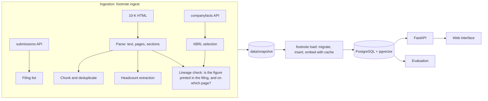
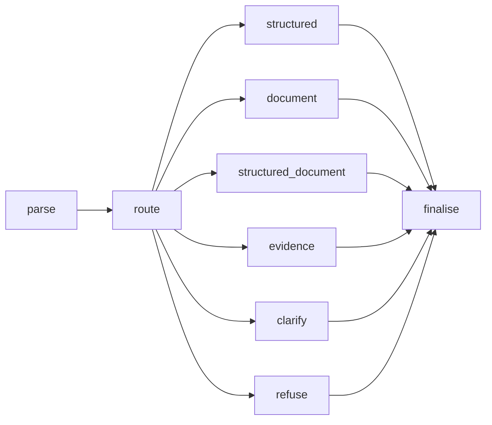

# Architecture

Footnote has two halves joined by a snapshot on disk. Ingestion turns SEC EDGAR into a versioned set of JSON Lines files. Everything else, the database, the API, the evaluation and CI, is rebuilt from that snapshot without contacting the SEC.

## Ingestion

**Client.** `sec.py` identifies itself with a contact address as the SEC requires, stays under ten requests a second, retries with exponential back-off, and caches every response in `data/raw`, so a second run makes no network calls.

**Figures.** `ingest/xbrl.py` reads the company-facts JSON for the tags in the catalogue. Three rules decide which value becomes the answer for a company, metric and fiscal year:

1. *Fiscal year.* An XBRL fact's `fy` field is the fiscal year of the filing that reported it. A 2024 10-K also reports 2023 and 2022, all tagged `fy=2024`. The period's own fiscal year is taken from the filing in which that period is the latest one reported.
2. *Tag priority.* Revenue is tagged differently across companies and years (`RevenueFromContractWithCustomerExcludingAssessedTax`, `Revenues`, and others). Tags are tried in a fixed order of preference for each year.
3. *Restatements.* When a later filing reports a different value for the same period, the later value is used and the original is kept in `restated_from`. Nine values were restated.

Free cash flow (operating cash flow less capital expenditure) and operating margin (operating income over revenue) are derived, never read, and carry the formula and the inputs they came from.

**Text.** `ingest/parse.py` converts the 10-K HTML to text. CSS page breaks become form feeds, and the printed page number is read from the footer on each page; a page number is trusted only through the offset between printed and physical page that most pages agree on, because a table's last cell can look like a page number. Sections are found by their "Item" headings. The contents page lists every item first, so for each item the heading with the longest span to the next item is taken, and a span stops at any later or earlier item's heading. Intel's 10-K is organised around its own headings and lists item numbers only in an index; a fallback finds those sections by title.

**Chunks.** `ingest/chunk.py` splits each section into passages of about 200 words that never cross a section boundary, keeps the page each passage starts on, and drops exact duplicates within a filing.

**Headcount.** Employee numbers are rarely tagged in XBRL, so `ingest/headcount.py` reads them from the human-capital paragraph with patterns ordered by reliability. A count qualified as one country or as excluding a group ("7,600 employees located in the United States") is recognised as a subset and not reported as the company total.

**Lineage check.** For every XBRL figure, ingestion searches the parsed filings for the figure as printed (in millions or thousands, or to the cent for EPS), first under the heading of the statement it belongs to. The page where it is found becomes the page a citation points to. 498 of 513 figures checked were found; 493 of those were under the heading of a named statement.

## Storage

PostgreSQL with pgvector holds companies, filings, sections, passages with their embeddings, every raw XBRL fact, the selected metric values, and a log of every answer. Migrations are plain numbered SQL files applied by `footnote migrate`. The full model is in [data-model.md](data-model.md).

Embeddings come from `all-MiniLM-L6-v2` running locally, so the corpus and the evaluation are reproducible offline and cost nothing per query. Vectors are cached in the snapshot by content hash at half precision; a fresh database is searchable in about fifteen seconds instead of three minutes.

## Answering

The answering pipeline is a LangGraph state graph with one decision point and no agent loop:

- `question.py` parses the question into companies, metrics, years, and flags for change, explanation, comparison, document intent, stated figures, and refusal triggers.
- `graph.decide_route` maps the parse to a route. The rules are in the [design note](design-note.md).
- `answers.py` builds a draft: segments of text, each with the citations behind it, plus calculations and the facts used.
- `analytics.py` runs parameterised SQL. Every query is parsed by `sqlguard.py` (one statement, `SELECT` only, allowed tables only, no dangerous functions, a literal `LIMIT` of at most 500) and then executed in a read-only transaction under the `footnote_reader` role with a three-second timeout.
- `retrieval.py` runs exact cosine search in pgvector inside the metadata filter and BM25 over the same filtered set, and fuses the two rankings with reciprocal rank fusion (k = 60).
- `evidence.py` selects the most relevant sentence from each of the best passages, rejecting headings, footnotes, cross-references and boilerplate.
- `verify.py` runs the checks and sets the status; `narrate.py` renders the text.

## Service

`api.py` serves the API and the web interface. It warms the embedding model and the BM25 index at start-up, limits each client to thirty questions a minute, caches identical questions for ten minutes, logs every answer to `answer_log`, writes structured JSON logs, and exposes Prometheus counters and a latency histogram at `/metrics`. `/health` fails unless the database answers and the corpus is loaded.

## Deployment

`compose.yaml` runs the API with a `pgvector/pgvector:pg16` database; the container applies migrations and loads the snapshot on first start. The image installs CPU-only PyTorch and bakes in the embedding model, so it starts without network access. `fly.toml` deploys the same image to Fly.io against a managed Postgres. GitHub Actions runs linting, type checks, the tests against a real pgvector service, and the evaluation, which fails the build below 90% correctness. A second workflow publishes the browser build, the case study and the reports to GitHub Pages.

## The browser build

GitHub Pages serves static files only, so the hosted demo runs the system inside the visitor's browser rather than on a server:

- **Python** runs under Pyodide (CPython compiled to WebAssembly). The page loads NumPy, Pydantic and SQLite from Pyodide, installs sqlglot, rank-bm25 and structlog with micropip, and unpacks the `footnote` package (everything except the server, database and ingestion modules).
- **Storage** is `MemoryBackend`: the committed snapshot loaded into an in-memory SQLite database (made read-only with `PRAGMA query_only`) and a NumPy matrix of the 5,618 passage embeddings. Generated SQL is the SQLite form of the same queries and passes the same sqlglot validation.
- **Embeddings** come from the same model, `all-MiniLM-L6-v2`, running under transformers.js. Python cannot call JavaScript synchronously, so the pipeline asks for what it needs: a request for an unseen text raises `EmbeddingsNeeded`, the page embeds those texts and runs the question again. The pipeline is deterministic, so the second run asks for exactly the same texts and completes; no question needs more than two rounds.
- **The graph** is the same node functions. Where LangGraph is not installed, as in the browser, they are walked in order by a small runner; the graph has one branch point and no cycles, so this is four function calls.

Parity is tested, not assumed. `tests/test_backends.py` checks that the two backends give identical answers, CI runs the full evaluation against both, and all 72 evaluation questions were run in a browser and compared with the server's answers: all 72 matched character for character.
