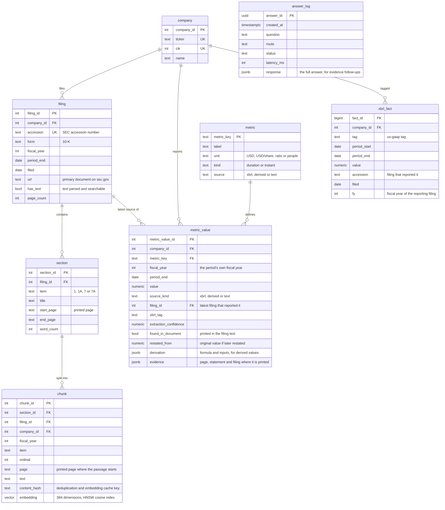

# Data model

## How a citation is assembled

A figure in an answer comes from one `metric_value` row. Its citation names the filing where the figure is printed (from `evidence.doc_accession`), the statement it sits in (`evidence.location`) and the printed page (`evidence.page`), and links to the document on sec.gov. Figures printed on the same page of the same report share one citation. A derived figure is cited through its inputs. A figure read from text (headcount) carries the sentence it was read from.

A quotation comes from one `chunk`. Its citation names the filing, the item and the page the passage starts on, and the verifier confirms the quoted sentence appears in that passage word for word.

## Grain and keys

- `metric_value` holds exactly one row per company, metric and fiscal year (`UNIQUE (company_id, metric_key, fiscal_year)`). Every answer about a figure reads this table.
- `xbrl_fact` holds every annual fact the SEC has for the tags in use, including values later restated, so any selection in `metric_value` can be audited back to the raw filings.
- `chunk.content_hash` is a hash of the normalised text. It removes duplicates within a filing and keys the embedding cache.

## Access

Generated SQL runs under the `footnote_reader` role, which can read `company`, `filing`, `metric` and `metric_value` and nothing else. It cannot see `answer_log` or the passage text, and it cannot write.
